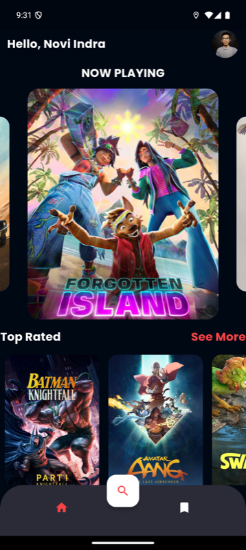
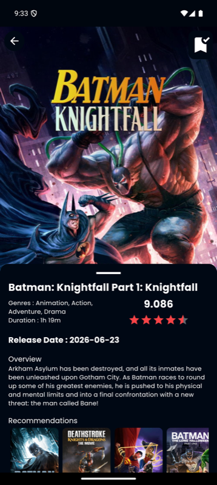
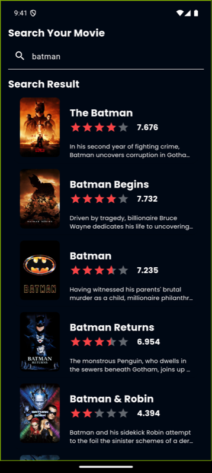
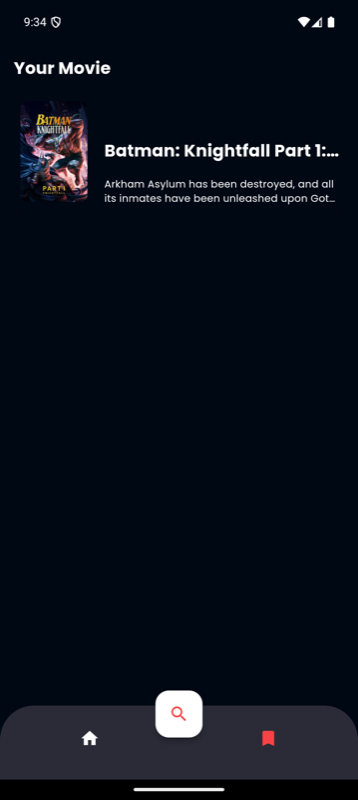

# Movierse – Movie Catalogue App (Flutter)

Movierse is a movie catalogue app built with **Flutter**, **Clean Architecture** and **BLoC**. It shows now playing, top rated and popular movies from [The Movie Database (TMDB)](https://www.themoviedb.org/), lets you search movies, open the details with recommendations, and save movies to a local watchlist.

<p>
  
  
  
  
</p>

## Features

- **Home:** now playing carousel, top rated and popular lists.
- **Detail:** poster, genres, rating, overview and recommended movies; add or remove the movie from the watchlist.
- **Search:** search movies by title.
- **Watchlist:** saved movies, stored offline in SQLite.
- **Profile:** developer profile page.
- **SSL pinning:** API requests only trust the certificate in `certificate/certificate.cer`.

## Architecture

```
lib/
  core/
    constant/      TMDB base URL, image URL and API key
    security/      SSL pinning HTTP client
    handling/      Failures, exceptions, request state
    routes/ styles/ utils/
  data/
    datasources/   TMDB remote data source, SQLite local data source (database/)
    models/        JSON and table models
    repositories/  Repository implementation
  domain/
    entities/      Movie, MovieDetail, Genre
    repositories/  Repository contract
    usecases/      One class per action (get now playing, search, save watchlist, ...)
  presentation/
    blocs/         now_playing, popular, top_rated, detail, recomendation, search, watchlist
    pages/         splash, main (bottom navigation), home, search, bookmark, detail, profile
    widgets/       Movie cards
  injection.dart   get_it setup
  app.dart, main.dart
```

## Tech stack

| Area | Packages |
|---|---|
| State management | `flutter_bloc`, `bloc`, `equatable` |
| Dependency injection | `get_it` |
| Functional error handling | `dartz` (`Either`) |
| Networking | `http` (`IOClient` with a pinned `SecurityContext`) |
| Local storage | `sqflite` |
| UI | `google_fonts`, `carousel_slider`, `cached_network_image`, `flutter_rating_bar` |

## Getting started

Requirements: Flutter 3.19 or newer (Dart `>=3.3.2`), an Android emulator or device.

```bash
flutter pub get
flutter run
```

The `movierse.apk` in the repository root was built with the previous pinned certificate, which expired in September 2024, so its API requests fail. Build a new APK with `flutter build apk --release`.

### SSL pinning certificate

`certificate/certificate.cer` holds the **Amazon Root CA 1** certificate, which issues the TMDB API certificates and is valid until 2038. If TMDB moves to another certificate authority, replace this file with the new root certificate:

```bash
openssl s_client -connect api.themoviedb.org:443 -showcerts </dev/null
```
